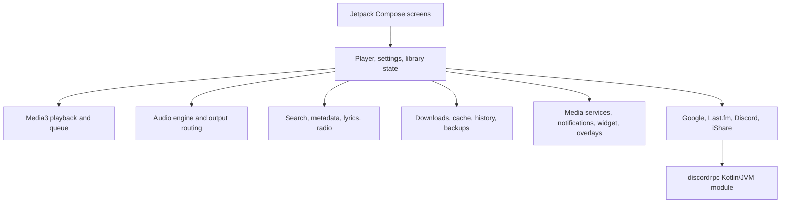

# iTune for Android

**iTune** is an Android music player built with Kotlin and Jetpack Compose. It brings online music discovery, a full-screen player, synchronized lyrics, audio processing, offline downloads, internet radio, and account/library tools into one app with an Apple-inspired dark interface.

- **Repository:** [d0x-dev/iTune](https://github.com/d0x-dev/iTune)
- **Project site:** [iTune for Android](https://d0x-dev.github.io/iTune/)
- **Downloads:** [GitHub Releases](https://github.com/d0x-dev/iTune/releases)
- **Application ID:** `com.darkxvenom.itune`
- **Current app version:** `1.0` (`versionCode` 1)
- **Minimum Android version:** Android 7.0 (API 24)

> Music sources, metadata, artwork, lyrics, and integrations depend on their upstream services and may change or be unavailable by region. Use the app and its download features only for content you are authorized to access and save.

## Contents

- [What iTune does](#what-itune-does)
- [Feature catalog](FEATURES.md)
- [Project layout](#project-layout)
- [How the app is structured](#how-the-app-is-structured)
- [Build requirements](#build-requirements)
- [Build and run](#build-and-run)
- [Tests](#tests)
- [Configuration and integrations](#configuration-and-integrations)
- [Permissions](#permissions)
- [Privacy and backups](#privacy-and-backups)
- [Troubleshooting](#troubleshooting)
- [Contributing](#contributing)
- [License](#license)

## Repository documents

| Document | Purpose |
| --- | --- |
| [Feature catalog](FEATURES.md) | Detailed inventory of app features and platform limitations |
| [Contributing](CONTRIBUTING.md) | Development setup and pull request guidance |
| [Code of Conduct](CODE_OF_CONDUCT.md) | Community participation standards |
| [Security](SECURITY.md) | Private vulnerability reporting and secret handling |
| [Copyright](COPYRIGHT.md) | Copyright ownership and third-party notices |
| [MIT License](LICENSE) | Reuse and redistribution terms for original project code |

## What iTune does

### Music, search, and library

- Search and browse songs, artists, albums, playlists, and other music collections.
- Open artist and album pages with artwork, track lists, and collection actions.
- Build and manage a playback queue, save favorites, and keep listening history and personal listening statistics.
- Import supported playlist links and sync supported library information when signed in.
- Download available audio streams, choose a preferred download quality, and cache songs for offline playback.
- Configure automatic downloads for liked or added tracks, cache quality, storage limits, and Wi-Fi behavior.

### Player and lyrics

- Full-screen player with artwork-driven presentation, playback controls, queue, output-device details, and optional dynamic artwork colors.
- Search for lyrics from multiple providers, prioritize or disable providers, and display time-synchronized lyrics when available.
- Optional lyric translation through a configured translation provider and user-supplied API key.
- Share selected lyrics as a styled card.
- Playback options include repeat, shuffle, crossfade, AutoMix, Afterglow, automatic skip after playback errors, and a recurring sleep schedule.

### Audio

- In-app audio engine with equalizer and supported sound effects, including low-pass filtering, spatial/8D modes, normalization, and a DJ panel.
- Output routing and USB DAC options, including bit-perfect output where the device and Android audio path support it.
- PCM output-format choices and audio-processing controls are device-dependent. Android, the device vendor, and connected hardware can limit or bypass effects.

### Radio and connected listening

- Online radio directory with regional browsing, search, favorites, and playback controls.
- Optional iShare listening sessions over supported connection modes.
- Optional Discord Rich Presence and Last.fm scrobbling from the account screen.
- Optional floating Dynamic Island-style controls and an Always-On Display player surface.
- Home-screen player widget with playback controls, layout presets, appearance options, artwork, favorite control, and an optional blurred artwork background.

### App settings and maintenance

- Dark, Apple-inspired Compose interface with app typography, haptics, liquid-glass surfaces, and player presentation options.
- Developer news and GitHub release update checks.
- Encrypted `.itune` backup and restore for selected account, settings, and library data; optional scheduled backups.
- Settings for network behavior, content region/language, explicit-content filtering, offline mode, history, cache, downloads, and playback behavior.

Feature availability depends on Android version, device hardware, selected providers, account state, and network access.

## Project layout

```text
.
├── app/                         Android application
│   └── src/
│       ├── main/java/com/darkxvenom/itune/
│       │   ├── audio/            Audio engine and output routing
│       │   ├── backend/          Playback, search, downloads, cache, lyrics
│       │   ├── data/             Account, library, settings, backup, integrations
│       │   ├── ishare/           Listening-session support
│       │   ├── island/           Floating playback surface and state
│       │   ├── radio/            Online radio
│       │   ├── recognition/      Music recognition flows
│       │   ├── ui/               Compose screens and components
│       │   └── widget/           Android home-screen player widget
│       ├── test/                 JVM unit tests
│       └── androidTest/          Instrumentation tests
├── discordrpc/                   Kotlin/JVM Discord RPC client module
├── gradle/                       Version catalog and Gradle wrapper
├── assets/                       App artwork and bundled visual assets
├── build.gradle.kts              Root Gradle configuration
└── settings.gradle.kts            Included Gradle modules and repositories
```

## How the app is structured

The app uses a single Android application module and a small Kotlin/JVM module for Discord RPC. Compose renders the screens; state and platform integrations live in focused backend/data packages.



Key areas:

| Package or module | Responsibility |
| --- | --- |
| `ui/` | Home, search, library, artist, player, lyrics, settings, account, and supporting Compose UI |
| `backend/MusicPlayerState.kt` | Playback state, queue, repeat/shuffle, transitions, and player lifecycle coordination |
| `backend/MusicBackend.kt` | Music search and audio-stream discovery |
| `backend/lyrics/` | Lyrics provider selection, synchronized lyrics, and translation support |
| `backend/AudioDownloader.kt` | Download work, notifications, and media-file saving |
| `backend/MusicCacheManager.kt` | Offline song cache and storage policy |
| `audio/` | Audio effects, output-device state, and USB/bit-perfect support |
| `data/library/` | App settings, library state, search history, and listening profile |
| `data/auth/`, `data/lastfm/`, `data/discord/` | Account/session handling and optional integrations |
| `data/backup/` | Encrypted backup/restore and scheduled backup work |
| `radio/`, `ishare/`, `island/`, `recognition/`, `widget/` | Independent platform-facing features |
| `discordrpc/` | RPC transport and Discord presence client |

## Build requirements

- Android Studio with support for the Android Gradle Plugin used by this project.
- JDK 21.
- Android SDK Platform 37.1 (the project compiles against API 37.1).
- Android SDK Build Tools installed through Android Studio.
- Internet access for the initial Gradle dependency download.

The repository includes a Gradle wrapper, so use `gradlew` rather than installing Gradle globally. Current wrapper and toolchain versions are defined in `gradle/wrapper/gradle-wrapper.properties`, `gradle/libs.versions.toml`, and `app/build.gradle.kts`.

## Build and run

### Android Studio

1. Clone the repository and open its root directory in Android Studio.
2. Allow Gradle to sync and install any requested Android SDK components.
3. Select the `app` run configuration and a device running Android 7.0 or later.
4. Run the app.

### Command line

From the repository root:

```bash
# Compile and package a debug APK
./gradlew :app:assembleDebug

# Install to a connected device or emulator
./gradlew :app:installDebug

# Run JVM unit tests
./gradlew :app:testDebugUnitTest
```

On Windows PowerShell, use the wrapper batch file:

```powershell
.\gradlew.bat :app:assembleDebug
.\gradlew.bat :app:installDebug
.\gradlew.bat :app:testDebugUnitTest
```

The debug APK is written to:

```text
app/build/outputs/apk/debug/app-debug.apk
```

### Release build

```bash
./gradlew :app:assembleRelease
```

The release build enables R8 code shrinking and resource shrinking. Configure release signing with your private keystore through an untracked local Gradle configuration or CI secrets. **Never commit signing keys, passwords, OAuth secrets, or service credentials.**

The application version is set in `app/build.gradle.kts` (`versionName` and `versionCode`). GitHub release tags are used by the in-app update checker; keep release tags consistent with the app version format, for example `1.0.0`.

## Tests

JVM tests live under `app/src/test`. They cover audio policies, lyrics providers, cache behavior, account and content parsing, settings normalization, playlist import, radio, and selected UI state policies. Instrumentation tests live under `app/src/androidTest`.

```bash
./gradlew :app:testDebugUnitTest
./gradlew :app:connectedDebugAndroidTest
```

The connected test task requires an available Android emulator or physical test device.

## Configuration and integrations

Most app preferences are configured inside **Settings**. Integrations that require a user account or external service are optional and may require network access or a user-provided credential.

- **Google account/library:** Sign in from the account flow to enable supported account-backed library features.
- **Lyrics translation:** Choose a provider and configure its endpoint/model/API key in Lyrics settings. Provider usage may incur charges under that provider’s terms.
- **Last.fm and Discord:** Connect from the account screen to enable scrobbling or listening presence.
- **iShare:** Create or join a session from its screen; connection mode and local-network availability can affect operation.
- **Automatic backup:** Enable it in Settings and choose a backup password. Keep that password safe; encrypted backup files cannot be restored without it.

No local `local.properties` file or release signing material should be committed. Android Studio creates `local.properties` for the local SDK path.

## Permissions

The app declares Android permissions for features that need network access, background playback, notifications, audio capture/recognition, Bluetooth output information, audio routing, downloads on older Android versions, or system overlays. Some permissions are requested only when a related feature is used.

| Permission group | Used for |
| --- | --- |
| Network and network state | Search, streaming, artwork, lyrics, radio, account services, and release/news checks |
| Media playback/data-sync foreground services and wake lock | Continuing playback and long-running download work |
| Notifications | Playback controls and download progress/completion notices |
| Microphone/audio capture | Music recognition or audio features that explicitly use input capture |
| Bluetooth connect | Reading the active Bluetooth output route and supported device details |
| System overlay | Optional floating player/Dynamic Island surface |
| Modify audio settings | Audio routing and supported sound controls |
| Legacy external storage (Android 9 and earlier) | Saving downloads on older Android versions |

Review Android’s permission prompt before enabling an optional feature. The app does not need every optional permission for basic playback UI.

## Privacy and backups

- Account connections and network features communicate with their respective providers.
- Translation API keys and account information should be treated as sensitive. Configure only services you trust.
- Portable `.itune` backups are password-encrypted. The backup flow asks which categories to include and scans a selected backup before restore.
- Scheduled backups are stored on-device in the configured backup directory. Keep an additional copy somewhere safe if you rely on them.
- Android Keystore-backed encryption is used for supported account secrets; behavior can vary on devices where the platform keystore is unavailable.
- Do not share an account backup or its password. A backup may contain account sessions, settings, library data, and history depending on the selected categories.

## Troubleshooting

### Gradle sync or build fails

- Confirm Android Studio is using JDK 21 for Gradle.
- Install the requested SDK Platform and Build Tools from SDK Manager.
- Retry with `./gradlew --stop` followed by the build command if a daemon is stale.
- The project configures an 8 GB Gradle heap in `gradle.properties`; close memory-heavy applications if the machine is under pressure.

### Widget is missing or shows “Can’t load widget”

- Install a current build and remove/re-add an old widget after updating if the launcher retained a stale RemoteViews instance.
- Confirm the launcher supports Android home-screen widgets and that iTune’s widget provider appears in its widget picker.
- Capture launcher and app logs with `adb logcat` when reporting a render failure.

### Downloads or media sources fail

- Check connectivity and the selected download quality.
- Android’s media storage behavior differs by API level; include the Android version and the full download notification/error text when reporting a failure.
- Upstream catalog or stream changes can temporarily break discovery without an app-side UI problem.

### Audio effects do not change output

- Check that the audio engine/effect is enabled and that Pure Audio Bypass or bit-perfect output is not bypassing effects.
- Effects depend on the active output route and may be limited by the device’s audio framework, USB DAC, Bluetooth codec, or another app claiming audio focus.

## Contributing

1. Create a focused branch for a change.
2. Keep UI, state, and platform work in their corresponding packages.
3. Avoid committing generated build output, local SDK paths, API tokens, account cookies, keystores, or backup files.
4. Run relevant unit tests and at least `:app:assembleDebug` before submitting a change.
5. Include the device/API level and useful `adb logcat` output for Android-specific defects.

For large changes, describe the user-visible behavior, settings involved, permission requirements, and any service or device limitations.

## License

Original iTune source code and documentation are available under the [MIT License](LICENSE). See [COPYRIGHT.md](COPYRIGHT.md) for the scope of that license and notes about third-party code, assets, and services. The MIT license does not grant rights to third-party media or services.
